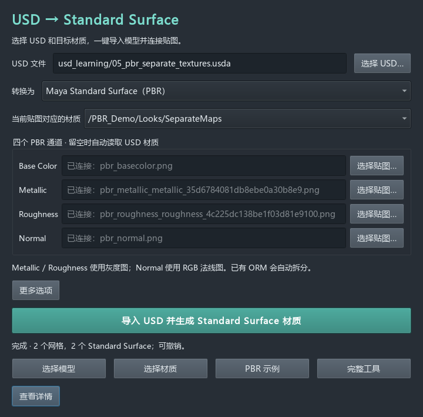

# Unreal USD Maya Bridge

[English](README_EN.md) · **Maya 接收端 v0.9.2** · Unreal 导出端 v0.5.0

把 Unreal 的静态布景通过 USD 带入 Maya 做 previs；也可独立导入已有 USD，
自动生成 Maya **Standard Surface** 或 **Phong 预览材质**，连接四个独立贴图通道。



## 快速开始

1. 在 Releases 下载 Maya 独立包，或下载并解压仓库。保留整个目录。
2. 启动 **Maya 2023**，把 `launch_usd_pbr_simple.py` 拖入视口。
3. 点击 **选择 USD**，选择目标材质，再点击 **导入 USD 并生成材质**。
4. 四个贴图栏留空即可读取 USD 已有材质；需要替换时分别选择图片。
5. 点击 **选择模型**，在视口按 **F** 居中、按 **6** 显示贴图。

点 **PBR 示例** 可以选择仓库附带的合成样例；它不会立即导入。
每次导入都会添加一份模型，可用 Maya 的撤销／重做操作处理。

无需 MCP、ChatGPT、API 密钥或 Python 包安装。仅异常兼容读取需要启动
当前 Maya 安装目录下配套的本机 `mayapy`。

完整安装与 Shelf 设置见 [安装指南](docs/INSTALLATION.md)。

## 四个通道

| 通道 | Standard Surface | Phong 预览 |
| --- | --- | --- |
| Base Color | `baseColor`，sRGB | `color`，并参与金属高光颜色近似 |
| Metallic | `metalness`，Raw | 近似控制漫反射、高光颜色和反射强度 |
| Roughness | `specularRoughness`，Raw | 经节点换算到 `cosinePower` |
| Normal | Raw → 切线空间 `bump2d` → `normalCamera` | 同左 |

USD 正确记录的 ORM 通道会拆成独立灰度 PNG，Roughness 和 Metallic 分别使用
自己的 file 节点。Normal 始终是独立 RGB 法线图。**Phong 是可编辑的预览近似，
不等价于 PBR 渲染。** 具体规则见 [材质映射](docs/MATERIAL_MAPPING.md)。

## Unreal → USD → Maya

```text
Unreal 静态 Actor / 组件 / 实例 / 摄影机
            │ launch_unreal_usd.py
            ▼
USD 场景 + 几何资源 + 来源清单
            │ launch_usd_pbr_simple.py
            ▼
Maya 原生模型 + 摄影机 + 目标材质
```

Unreal 导出器用于静态灰模与摄影机交接，**不导出任意 UE 材质图或烘焙贴图**。
已有 UsdPreviewSurface 材质的外部 USD 可以直接走 Maya 转换。
两端通过文件交接，不需要同时运行。见 [Unreal 导出指南](docs/UNREAL_EXPORT.md)。

## 已验证环境与支持边界

| 项目 | 范围 |
| --- | --- |
| Maya | Windows、Maya 2023、Maya USD 0.16.0、USD SDK 0.21.11 |
| Unreal | 现有导出器在本机 UE 5.8.4 验收；其他版本未承诺支持 |
| 场景 | 静态 Mesh、变换、逐面材质绑定、受支持的透视摄影机 |
| 单位 | USD 与 Maya 都要求厘米、Y-up，不隐式改变工作场景单位 |
| 材质 | 静态 UsdPreviewSurface 金属／粗糙度工作流、直接纹理、st UV、repeat |
| 手动图片 | PNG / JPEG；法线使用切线空间 RGB |

当前不转换动画、骨骼、UDIM、MaterialX、Gazebo、透明、位移、AO 合成、自发光、
UV 变换或任意 UE 材质网络。Nanite 仅可明确选择现有渲染／回退代理，
不还原完整 Nanite 源几何。详见 [用户指南](docs/USER_GUIDE.md)。

## 空网格兼容读取

若源 USD 有网格而当前 Maya 原生导入只创建空层级，工具会清理本次空层级，
在独立的本机 Maya 进程读取几何，再带回当前操作继续接图。
它不卸载工作会话插件、不清空撤销历史，也不改写源 USD。

兼容路径有额外启动时间，可能展开共享实例，增加大场景内存开销。
普通成功导入仍使用原路径。见 [故障排查](docs/TROUBLESHOOTING.md)。

## 文档

- [安装](docs/INSTALLATION.md) / [使用](docs/USER_GUIDE.md)
- [材质与颜色空间](docs/MATERIAL_MAPPING.md) / [Unreal 导出](docs/UNREAL_EXPORT.md)
- [故障排查](docs/TROUBLESHOOTING.md) / [开发与测试](docs/DEVELOPMENT.md)
- [验证范围](docs/VALIDATION.md) / [更新记录](CHANGELOG.md)
- [贡献说明](CONTRIBUTING.md) / [版权](LICENSE) / [第三方说明](THIRD_PARTY_NOTICES.md)

## 开发验证

```bash
python -m unittest discover -s tests/unit -p "test_*.py"
python scripts/check_repository.py
python scripts/build_release.py
```

Maya 集成测试必须在独立 `mayapy` 中运行，见开发文档。
GitHub CI 检查纯 Python 测试、格式和发布目录；它不代表运行过商业 DCC。

## 版权

当前保留版权，尚未授予开源再分发许可。用户自行安装的 DCC 与单独取得的模型
受各自许可约束；仓库仅包含原创合成测试资源。
